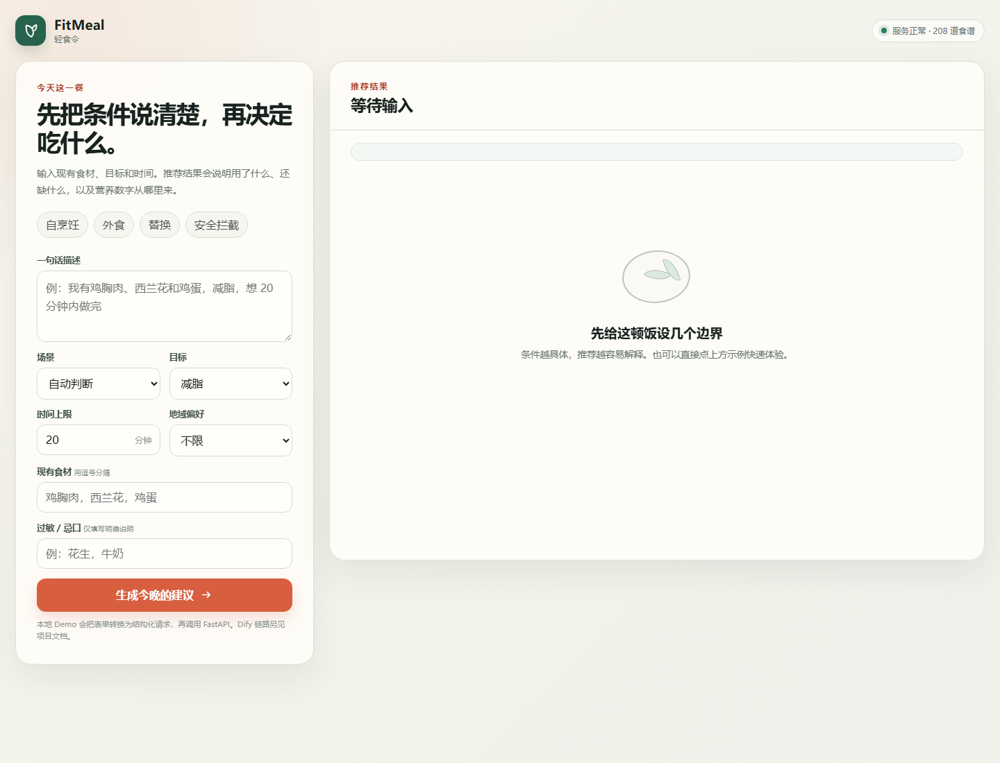
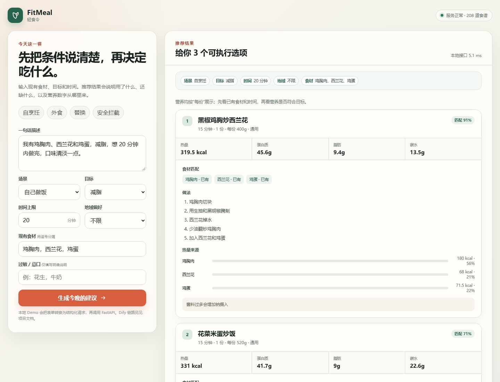
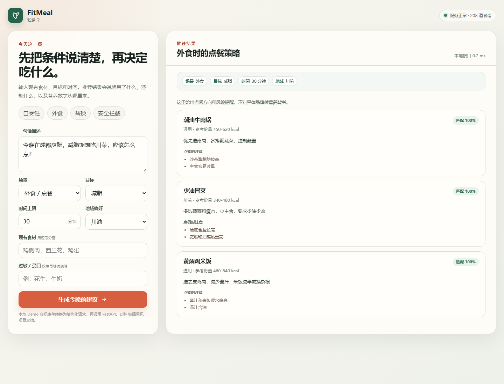
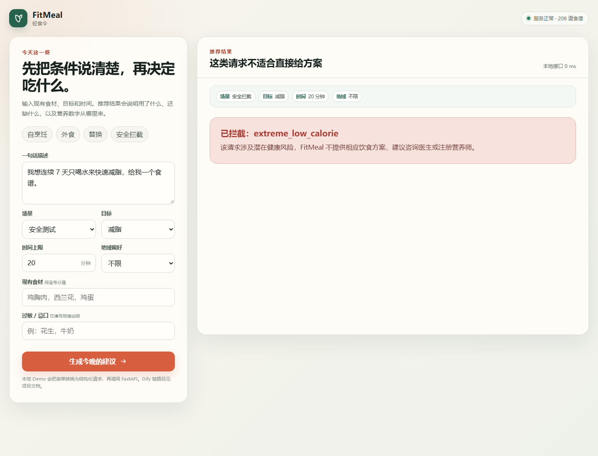

# FitMeal 轻食令

FitMeal 是一个面向健身人群的饮食决策助手。用户可以用一句话说明现有食材、健身目标、时间限制和地域偏好，系统输出可执行的食谱、外食建议、食材替换或营养说明。

当前可运行的是本地 Demo、规则与数据服务、Dify 调用链和 270 条结构化评测集。首轮结果包含未修复问题，不能视为上线版本。前端位于 `web/`，可以通过本地 FastAPI 服务直接运行。

## 已实现范围

1. 自然语言输入、意图识别和参数抽取。
2. 自烹饪食谱推荐，包含现有食材、缺失食材、替换建议和制作步骤。
3. 减脂、增肌和维持三类目标，按营养规则筛选候选。
4. 外食类型与点餐策略建议。
5. 食材替换建议和营养变化说明。
6. 营养查询、来源说明和安全拦截。
7. 过敏原候选过滤；极端低热量、极端单一饮食、医疗条件和不安全建议的请求拦截。
8. 份数、每份重量、每份营养和食材级营养拆解。

## 设计约束

1. 大模型负责理解、解释和表达，不负责营养计算和候选筛选。
2. 筛选、评分、过敏过滤和营养计算由 Python 与数据表完成，结果可以追溯。
3. 没有合适候选时，不编造食谱或营养数据，应该追问、说明限制或给出降级方案。
4. 安全场景优先于推荐场景，安全拦截结果不能继续进入普通推荐。
5. 评测集区分开发集和验收集；验收集不用于调参，不用删样本或放宽规则制造通过率。

## 项目结构

```text
data/         食谱、营养、外食、目标规则、替换规则、别名和单位换算
server/       FastAPI 数据服务与静态前端入口
web/          本地可交互前端和运行截图
scripts/      数据校验、推荐、评测、覆盖诊断和数据录入
evals/        正式评测集、评分规则和能力矩阵
docs/         PRD、架构、接口、安全、数据治理和评测说明
prototypes/   页面结构、交互流程和原型说明
```

## 一键启动（Windows）

本项目提供双击启动入口：

```text
启动FitMeal.bat
```

双击后会自动启动本地服务并打开：

- 前端 Demo：`http://127.0.0.1:8765/app/`
- 健康检查：`http://127.0.0.1:8765/health`

服务窗口需要保持打开。停止服务时在该窗口按 `Ctrl+C`。本项目使用 `uv` 管理 Python 3.12；如果电脑上没有 `uv`，启动脚本会给出提示。

## 手动运行

项目使用 Python 3.12。推荐在项目根目录使用 `uv` 运行：

```powershell
uv run --python 3.12 python scripts/validate_data.py
uv run --python 3.12 python scripts/run_eval_set.py --cases evals/eval_set.csv
```

启动本地服务：

```powershell
uv run --python 3.12 --with fastapi --with uvicorn uvicorn app:app --app-dir server --host 127.0.0.1 --port 8765
```

服务启动后打开：

- 前端 Demo：`http://127.0.0.1:8765/app/`
- 健康检查：`http://127.0.0.1:8765/health`

健康检查会返回各表行数。当前快照为食谱 208、营养 159、外食 50、目标规则 3、替换规则 30、别名 24、单位换算 19。

## 前端 Demo 的边界

`web/` 里的前端通过表单生成结构化请求，直接调用本地 FastAPI 的 `POST /recommend` 接口。它用于展示推荐结果、营养拆解、安全拦截和五类使用路径。

Dify Chatflow 是另一条真实 API 调用链，包含参数抽取、安全判断、意图分类、数据服务调用和回答生成。作品集和评测材料会分别说明两条链路，不把本地前端结果和 Dify API 结果混写。

## 原型截图








## 评测说明

正式评测集为 `evals/eval_set.csv`，共 270 条：

- 开发集 219 条，验收集 51 条。
- 安全风险、意图、参数、推荐、替换、营养和语言边界均有覆盖。
- 代码层回归检查规则、数据和本地筛选逻辑。
- 真实 API 首轮检查 Dify Chatflow、LLM、FastAPI 和回答生成的完整链路。

当前代码层版本为 `bv-a3e6abe13870`。最新复跑结果为 234 pass、10 fail、14 条待人工或 LLM 评分、12 条 F10 未实现占位；开发集为 190 / 8 / 11 / 10，验收集为 44 / 2 / 3 / 2。运行文件 `evals/runs/20261009T105524Z_code_bv-a3e6abe13870.csv` 只在本地保留，Git 仓库提交汇总和复现命令，不提交原始请求与回包。

首轮真实 API 结果是修复前基线：意图准确率 95.4%，目标抽取 91.3%，JSON 解析 100%，安全 LLM 判定 88.9%，过敏自动口径 14.3%，食材抽取 52.5%，P95 延迟 26.08 秒。该批次通过 196 条、失败 58 条、阻塞 3 条、未就绪 12 条、请求错误 1 条。

这些结果说明理解和格式化能力已经接近可用水平，但安全、过敏、信息追问和食材治理还没有达到上线要求。过敏指标需要先人工复核，不能只根据字符串命中直接判断“推荐了过敏原”。

## 文档索引

| 文档 | 说明 |
| --- | --- |
| `docs/requirements-analysis.md` | 用户、场景、需求优先级和未验证假设 |
| `docs/PRD.md` | 产品需求、流程、功能、安全和验收标准 |
| `docs/architecture.md` | 系统组件、数据流和职责边界 |
| `docs/api-contract.md` | 输入输出接口与 JSON 结构 |
| `docs/safety-spec.md` | 安全与过敏处理规则 |
| `docs/evaluation-summary.md` | 首轮评测结果和产品决策 |
| `docs/evaluation-plan.md` | 评测范围与能力冻结 |
| `docs/eval-maintenance-plan.md` | 评测集维护与复跑规则 |
| `docs/data-governance.md` | 数据来源、版本和隔离规则 |
| `docs/data-dictionary.md` | 数据表字段说明 |
| `prototypes/screens.md` | 页面结构和交互说明 |
| `evals/showcase_results.md` | 面试演示案例、证据和讲解口径 |
| `docs/interview-demo-guide.md` | 面试演示顺序、示例输入和讲解边界 |
| `docs/project-status-and-artifacts.md` | 项目现状、已实现范围、交付物和当前限制 |

## 当前限制

1. 规则区间是候选评分信号，不是所有食谱的绝对门槛；仍有一部分食谱营养值需要继续校准。
2. 过敏自动断言存在安全提示词误判，下一轮需要把机器断言和人工复核分开。
3. 缺少食材或目标时会直接推荐的问题还没有修完，应增加强制追问规则。
4. 真实 API P95 延迟为 26.08 秒，主要来自串行模型调用和同步数据检索；安全与澄清修复后再处理性能。
5. F10 用户反馈尚未实现，评测集中保留占位并能显示为 `not_ready`。
6. 真实用户测试尚未完成，当前不能宣称采纳率或决策率已经达到目标。

