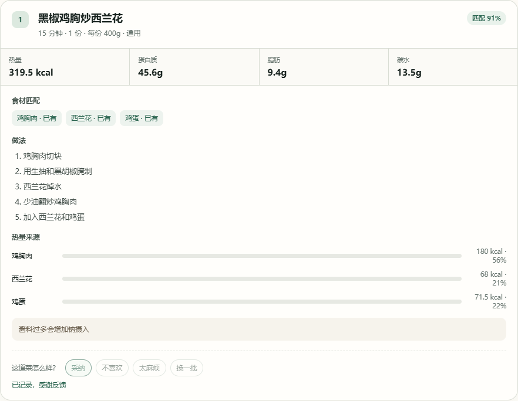

# FitMeal 轻食令

FitMeal 是一个面向健身人群的饮食决策助手。用户可以用一句话说明现有食材、健身目标、时间限制和地域偏好，系统输出可执行的食谱、外食建议、食材替换或营养说明。

当前可运行的是 Dify Chatflow 端到端 Demo、规则与数据服务、确定性营养计算器和 270 条结构化评测集。首轮结果包含未修复问题，不能视为上线版本。浏览器通过本地 FastAPI 的 `/chat` 代理调用 Dify，前端不持有 API Key，也不回退到本地规则链路；营养计算器是独立的本地工具，不经过 Dify，也不调用大模型。

## 已实现范围

1. 自然语言输入、意图识别和参数抽取。
2. 自烹饪食谱推荐，包含现有食材、缺失食材、替换建议和制作步骤。
3. 减脂、增肌和维持三类目标，按营养规则筛选候选。
4. 外食类型与点餐策略建议。
5. 食材替换建议和营养变化说明。
6. 营养查询、来源说明和安全拦截。
7. 过敏原候选过滤；极端低热量、极端单一饮食、医疗条件和不安全建议的请求拦截。
8. 份数、每份重量、每份营养和食材级营养拆解。
9. 回答级的“有帮助 / 没帮助”反馈记录；反馈不会自动改变下一次推荐。
10. 独立营养计算器：输入食材和克重，返回整份与每份热量、蛋白质、脂肪、碳水和膳食纤维，并展示食材级占比、来源和未识别项。

## 设计约束

1. 大模型负责理解、解释和表达，不负责营养计算和候选筛选。
2. 筛选、评分、过敏过滤和营养计算由 Python 与数据表完成，结果可以追溯。
3. 没有合适候选时，不编造食谱或营养数据，应该追问、说明限制或给出降级方案。
4. 安全场景优先于推荐场景，安全拦截结果不能继续进入普通推荐。
5. 评测集区分开发集和验收集；验收集不用于调参，不用删样本或放宽规则制造通过率。

## 项目结构

```text
data/         食谱、营养、外食、目标规则、替换规则、别名和单位换算
server/       FastAPI 数据服务与静态前端入口
web/          本地可交互前端和运行截图
scripts/      数据校验、推荐、评测、覆盖诊断和数据录入
evals/        正式评测集、评分规则和能力矩阵
docs/         PRD、架构、接口、安全、数据治理和评测说明
prototypes/   页面结构、交互流程和原型说明
```

## 运行前准备

复制环境变量模板并填入 Dify 应用 Token：

```powershell
Copy-Item .env.example .env
```

`.env` 已被 Git 忽略，只保存在本机。前端、截图和公开仓库都不能包含 `DIFY_API_KEY`。除 FitMeal API 外，演示 Dify 完整链路还需要 Dify 服务与本地向量服务 `8766` 在线；Dify 工作流仍通过 `/recommend` 调用营养计算和候选筛选。

## 一键启动（Windows）

先自行启动 Dify 和 Docker Desktop，确认 Dify 控制台可访问。然后在项目根目录双击：

```text
启动FitMeal.bat
```

启动脚本会自动完成：

- 检查 `.env` 与 Dify 连接；
- 启动本地向量服务 `8766`（如果尚未运行）；
- 启动 FitMeal 数据与前端服务 `8765`；
- 打开前端 Demo：`http://127.0.0.1:8765/app/`

服务窗口需要保持打开。停止 FitMeal 时在该窗口按 `Ctrl+C`；向量服务日志位于 `D:\Desktop\ai\embed-server\logs`。本项目使用 `uv` 管理 Python 3.12；如果电脑上没有 `uv`，启动脚本会给出提示。

## 手动运行

项目使用 Python 3.12。推荐在项目根目录使用 `uv` 运行：

```powershell
uv run --python 3.12 python scripts/validate_data.py
uv run --python 3.12 python scripts/run_eval_set.py --cases evals/eval_set.csv
```

启动本地服务：

```powershell
uv run --python 3.12 --with fastapi --with uvicorn uvicorn app:app --app-dir server --host 127.0.0.1 --port 8765
```

服务启动后打开：

- 前端 Demo：`http://127.0.0.1:8765/app/`
- 营养计算器：`http://127.0.0.1:8765/app/nutrition.html`
- 数据录入台：`http://127.0.0.1:8765/app/data.html`
- 数据总览：`http://127.0.0.1:8765/app/overview.html`
- 健康检查：`http://127.0.0.1:8765/health`

健康检查会返回各表行数和 Dify 代理配置状态。当前快照为食谱 208、营养 159、外食 50、目标规则 3、替换规则 30、别名 24、单位换算 19；`target_ingredients.csv` 另有 48 行施工单，用于食材覆盖追踪，不参与推荐排序或营养计算。

## 前端 Demo 的边界

`web/` 里的前端只收集一句自然语言，调用本地 FastAPI 的 `POST /chat`。FastAPI 从 `.env` 读取应用 Token，再代理到 Dify Chatflow；浏览器拿不到密钥，也不会在 Dify 不可用时静默切换到本地规则。

`POST /recommend` 仍然保留，但只作为 Dify 工作流内部的数据节点，负责筛选、评分、过敏过滤和营养计算。页面会显示真实链路标注和端到端耗时，作品集不能把 `/recommend` 的毫秒级耗时冒充 Dify 延迟。

## 确定性营养计算器

营养计算器面向“我已经知道用了哪些食材和多少克，只想算营养”的场景。页面调用 `POST /nutrition/calculate`，请求体只包含食材、克重和份数：

```json
{
  "items": [
    {"name": "鸡胸肉", "amount_g": 150},
    {"name": "西兰花", "amount_g": 200}
  ],
  "servings": 2
}
```

返回值包含整份总营养、每份营养、食材级拆解、热量占比、数据来源和未识别食材。计算只使用 `data/nutrition.csv` 和别名表，不调用 LLM，不经过 Dify，也不写入数据表。当前输入口径是克重，不把“个 / 瓣 / 碗”等非重量单位自动折算；未识别食材会单独暴露，不会被静默按 0 计入合计。

## 原型截图

> 下列截图记录的是改造前的结构化表单版本；当前 Dify 单输入版与回答级反馈界面以 `web/` 代码为准，待统一重拍。





## 评测说明

正式评测集为 `evals/eval_set.csv`，共 270 条：

- 开发集 219 条，验收集 51 条。
- 安全风险、意图、参数、推荐、替换、营养和语言边界均有覆盖。
- 代码层回归检查规则、数据和本地筛选逻辑。
- 真实 API 首轮检查 Dify Chatflow、LLM、FastAPI 和回答生成的完整链路。

当前代码层版本为 `bv-a3e6abe13870`。最新复跑结果为 234 pass、10 fail、14 条待人工或 LLM 评分、12 条对话式反馈用例未就绪；开发集为 190 / 8 / 11 / 10，验收集为 44 / 2 / 3 / 2。最小反馈事件记录由 `scripts/check_feedback_store.py` 单独验证，不计入这 12 条的通过口径。运行文件 `evals/runs/20261009T105524Z_code_bv-a3e6abe13870.csv` 只在本地保留，Git 仓库提交汇总和复现命令，不提交原始请求与回包。

首轮真实 API 结果是修复前基线：意图准确率 95.4%，目标抽取 91.3%，JSON 解析 100%，安全 LLM 判定 88.9%，过敏自动口径 14.3%，食材抽取 52.5%，P95 延迟 26.08 秒。该批次通过 196 条、失败 58 条、阻塞 3 条、未就绪 12 条、请求错误 1 条。

这些结果说明理解和格式化能力已经接近可用水平，但安全、过敏、信息追问和食材治理还没有达到上线要求。过敏指标需要先人工复核，不能只根据字符串命中直接判断“推荐了过敏原”。

## 文档索引

| 文档 | 说明 |
| --- | --- |
| `docs/requirements-analysis.md` | 用户、场景、需求优先级和未验证假设 |
| `docs/PRD.md` | 产品需求、流程、功能、安全和验收标准 |
| `docs/modao-prototype-prompt.md` | 墨刀 AI 低保真原型主提示词、补全提示词和检查清单 |
| `docs/architecture.md` | 系统组件、数据流和职责边界 |
| `docs/api-contract.md` | 输入输出接口与 JSON 结构 |
| `docs/safety-spec.md` | 安全与过敏处理规则 |
| `docs/evaluation-summary.md` | 首轮评测结果和产品决策 |
| `docs/evaluation-plan.md` | 评测范围与能力冻结 |
| `docs/evaluation-pipeline.md` | 用例来源、构建、运行、判定和结果解释链路 |
| `docs/eval-maintenance-plan.md` | 评测集维护与复跑规则 |
| `docs/data-governance.md` | 数据来源、版本和隔离规则 |
| `docs/data-dictionary.md` | 数据表字段说明 |
| `prototypes/screens.md` | 页面结构和交互说明 |
| `evals/showcase_results.md` | 面试演示案例、证据和讲解口径 |
| `docs/interview-demo-guide.md` | 面试演示顺序、示例输入和讲解边界 |
| `docs/project-status-and-artifacts.md` | 项目现状、已实现范围、交付物和当前限制 |

## 当前限制

1. 规则区间是候选评分信号，不是所有食谱的绝对门槛；仍有一部分食谱营养值需要继续校准。
2. 过敏自动断言存在安全提示词误判，下一轮需要把机器断言和人工复核分开。
3. 缺少食材或目标时会直接推荐的问题还没有修完，应增加强制追问规则。
4. 真实 API P95 延迟为 26.08 秒，主要来自串行模型调用和同步数据检索；安全与澄清修复后再处理性能。
5. F10 只完成最小反馈事件记录；12 条对话式反馈用例仍为 `not_ready`。反馈不会自动改变推荐，跨会话偏好、对话反馈理解和排序闭环尚未实现。
6. 真实用户测试尚未完成，当前不能宣称采纳率或决策率已经达到目标。
7. 营养计算器依赖现有营养表和别名，且当前只接收克重；未覆盖食材会返回 `unresolved`，需要先补齐数据再复算。接口、页面和离线确定性回归已通过 `scripts/check_nutrition_calculator.py`，但仍未做真实用户验证，不代表用户已经使用或认可该工具。

