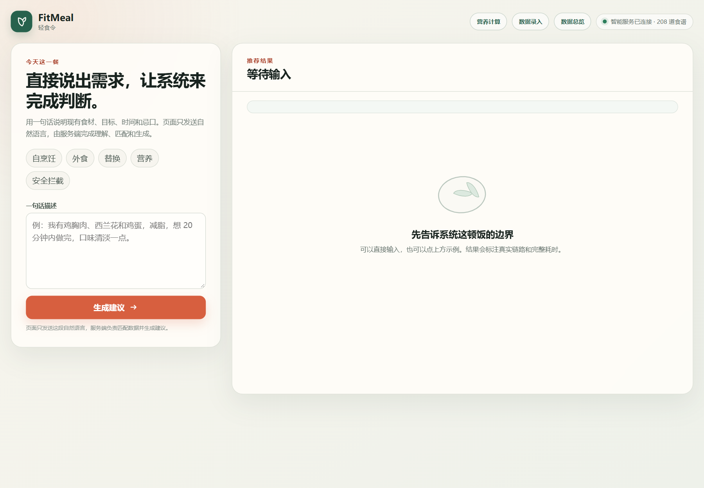
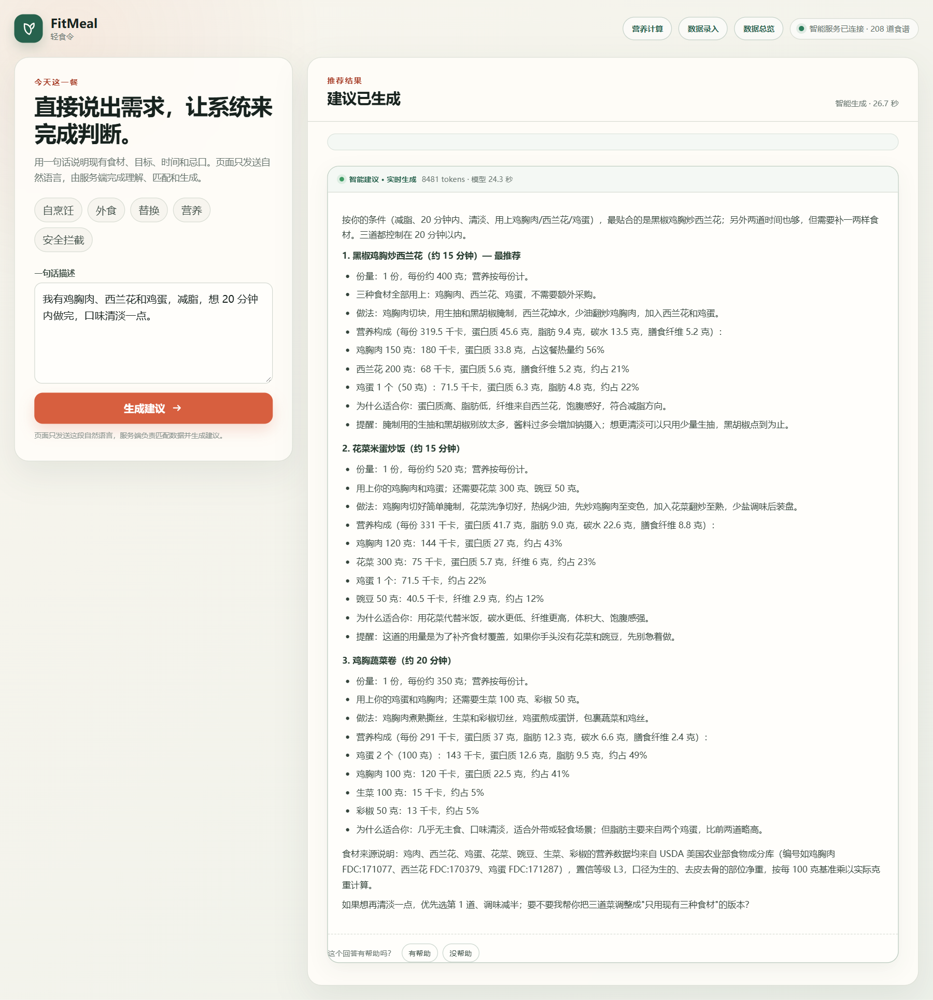
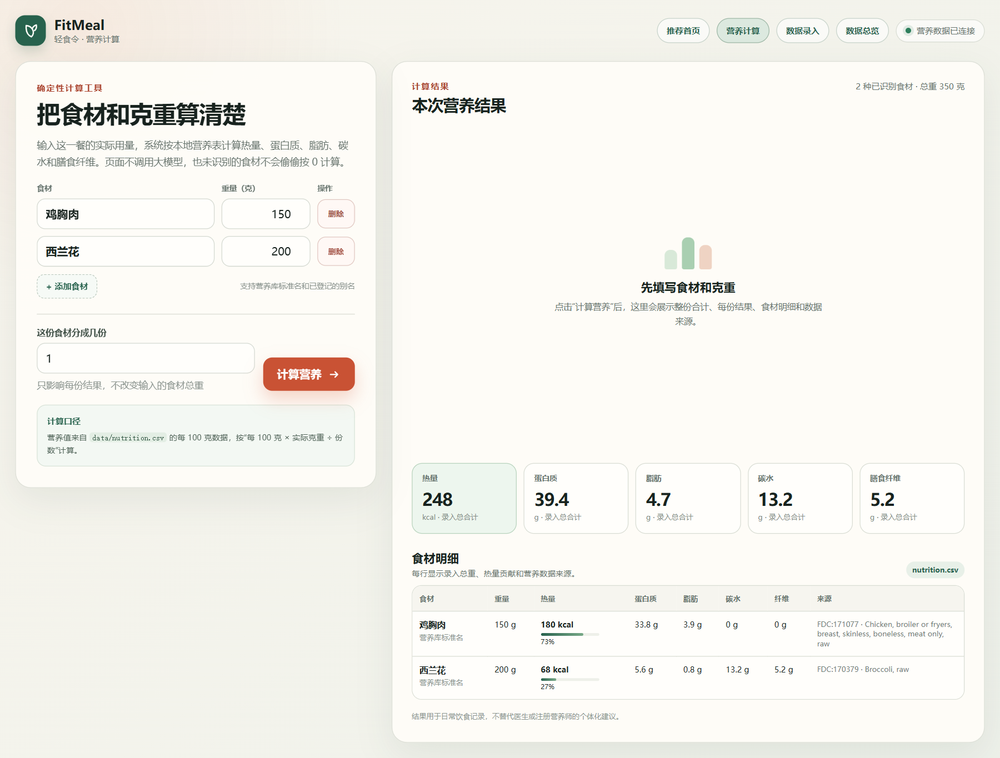
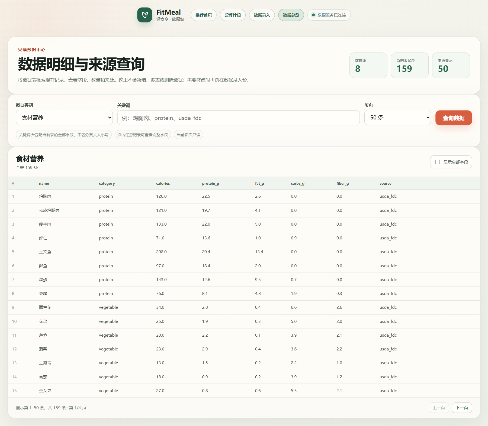
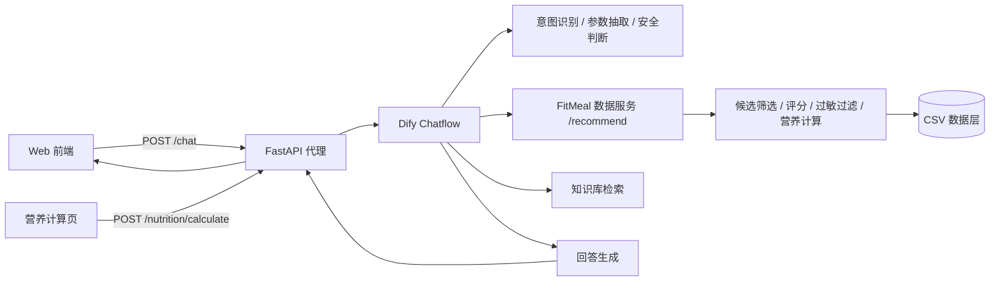

# FitMeal 轻食令

> 把冰箱里的食材、正在执行的健身目标和现实限制，收敛成这一顿可以执行的建议。


FitMeal 是一个饮食决策助手 Demo。用户不需要先选菜或填一堆筛选条件，只要用一句话说明现有食材、减脂或增肌目标、时间、地域和忌口，系统就会给出可执行的自烹饪食谱、外食点餐策略、食材替换或营养解释。

项目将自然语言理解和回答生成交给 Dify Chatflow，将营养计算、候选筛选、过敏过滤和数值来源留在可复现的 Python 数据层。前端不持有 API Key，也不会在智能工作流不可用时静默切换到另一套结果。

## 运行效果

<p align="center">
  
</p>

<table>
  <tr>
    <td width="50%"></td>
    <td width="50%"></td>
  </tr>
  <tr>
    <td align="center"><sub>一句话输入，服务端完成理解、筛选和生成</sub></td>
    <td align="center"><sub>按食材和克重计算营养，不调用大模型</sub></td>
  </tr>
</table>

<p align="center">
  
</p>

## 解决的问题

普通菜谱产品回答的是“有什么菜可以做”。FitMeal 处理的是更具体的当下问题：“以我现在有的食材、目标和时间，这顿应该选什么，为什么？”

核心任务包括：

- 在现有食材、时间、厨具和目标之间做推荐，并明确缺失食材。
- 把外食场景转成可点、可执行的策略，而不是只给菜名。
- 对替换、份数、每份重量和食材级营养给出可追溯的数字。
- 识别极端节食、医疗条件和过敏风险，优先停止不安全建议。
- 信息不足时先追问，没有合适候选时说明限制，不编造结果。

## 核心能力

| 模块 | 能力 | 当前实现 |
| --- | --- | --- |
| 统一入口 | 一句话识别自烹饪、外食、替换、营养和安全请求 | Dify Chatflow + FastAPI 代理 |
| 推荐决策 | 按食材、目标、时间、地域和风险筛选候选 | Python 数据服务与 CSV 规则层 |
| 营养计算 | 整份、每份、食材级拆解、热量占比和数据来源 | `POST /nutrition/calculate`，确定性计算 |
| 数据工具 | 数据录入、字段查询、只读总览与来源核对 | FastAPI + Web 页面 |
| 质量保障 | 开发集 / 验收集、代码层回归和真实 API 评测 | 270 条结构化用例 |
| 用户反馈 | 回答级“有用 / 没用”事件记录 | 只记录事件，暂不驱动排序 |

## 产品与技术原则

1. **数字不由大模型心算。** 热量、蛋白质、脂肪、碳水和膳食纤维来自固定营养表，按克重计算。
2. **事实和生成分开。** 模型负责理解、解释和表达；候选筛选、过敏过滤和营养计算由 Python 完成。
3. **没有依据时停下来。** 缺少关键信息时先追问；没有候选或数据未登记时明确暴露，不用相近结果凑数。
4. **安全优先于推荐。** 极端节食、医疗条件和明确过敏项先进入安全或过滤路径。
5. **评测不挑成功样本。** 开发集用于定位问题，验收集只用于验收；失败用例和未完成能力保留在记录里。

## 技术链路



- 浏览器只向本地 FastAPI 发送自然语言，Dify Token 留在服务端 `.env`。
- `/recommend` 是 Dify 工作流内部的数据节点，不参与前端伪加速，也不回退为本地规则结果。
- 独立营养计算器不经过 Dify、不调用 LLM，停止智能工作流后仍可单独运行。

## 评测结果

正式评测集包含 270 条用例：219 条开发集、51 条验收集，覆盖推荐、外食、替换、安全、澄清、不匹配、营养和反馈占位。

代码层回归（只调用规则、数据和本地筛选）：

| 划分 | 通过 | 失败 | 待人工 / LLM 评分 | 未就绪 | 合计 |
| --- | ---: | ---: | ---: | ---: | ---: |
| 开发集 | 190 | 8 | 11 | 10 | 219 |
| 验收集 | 44 | 2 | 3 | 2 | 51 |
| 合计 | 234 | 10 | 14 | 12 | 270 |

首轮真实 API 基线（修复前，不等于当前上线结果）：

| 指标 | 结果 | 目标 |
| --- | ---: | ---: |
| 意图准确率 | 95.4% | ≥95% |
| 目标抽取准确率 | 91.3% | ≥90% |
| JSON 解析通过率 | 100% | 100% |
| 安全 LLM 判定准确率 | 88.9% | ≥95% |
| 食材抽取准确率 | 52.5% | ≥90% |
| P95 响应时间 | 26.08s | ≤8s |

结论是：理解与格式化已经接近可用水平，但安全判定、澄清追问、食材治理和延迟仍是上线前必须修复的问题。详细口径见 [`docs/evaluation-summary.md`](docs/evaluation-summary.md) 与 [`evals/README.md`](evals/README.md)。

## 项目结构

```text
data/         食谱、营养、外食、替换、目标规则、别名和单位换算
server/       FastAPI 数据服务、Dify 代理和静态前端入口
web/          推荐首页、营养计算、数据录入和数据总览
scripts/      数据校验、推荐、营养计算、评测、覆盖诊断和数据录入
evals/        正式评测集、评分规则、能力矩阵和汇总说明
docs/         PRD、架构、接口、安全、数据治理和评测文档
prototypes/   页面结构与交互说明
```

## 本地运行

项目使用 Python 3.12 和 `uv`。前端与 FastAPI 可单独启动；完整智能链路还需要本机配置 Dify 与向量服务，这些环境、Token 和启动脚本不进入公开仓库。

```powershell
Copy-Item .env.example .env

# 数据校验
uv run --python 3.12 python scripts/validate_data.py

# 启动本地服务
uv run --python 3.12 --with fastapi --with uvicorn uvicorn app:app --app-dir server --host 127.0.0.1 --port 8765
```

服务启动后：

- 推荐首页：<http://127.0.0.1:8765/app/>
- 营养计算：<http://127.0.0.1:8765/app/nutrition.html>
- 数据总览：<http://127.0.0.1:8765/app/overview.html>
- 健康检查：<http://127.0.0.1:8765/health>

## 文档索引

| 文档 | 说明 |
| --- | --- |
| [`docs/requirements-analysis.md`](docs/requirements-analysis.md) | 用户、场景、需求优先级和未验证假设 |
| [`docs/PRD.md`](docs/PRD.md) | 产品范围、交互、功能、安全与验收标准 |
| [`docs/architecture.md`](docs/architecture.md) | 系统组件、数据流和职责边界 |
| [`docs/api-contract.md`](docs/api-contract.md) | 接口、字段和错误结构 |
| [`docs/safety-spec.md`](docs/safety-spec.md) | 安全与过敏处理规则 |
| [`docs/evaluation-plan.md`](docs/evaluation-plan.md) | 评测范围与能力冻结 |
| [`docs/evaluation-pipeline.md`](docs/evaluation-pipeline.md) | 用例构建、运行、判定和结果解释 |
| [`docs/evaluation-summary.md`](docs/evaluation-summary.md) | 代码层与真实 API 结果 |
| [`docs/data-governance.md`](docs/data-governance.md) | 数据来源、版本和隔离规则 |
| [`docs/data-dictionary.md`](docs/data-dictionary.md) | 数据表字段定义 |
| [`docs/data-entry-guide.md`](docs/data-entry-guide.md) | 数据录入与维护说明 |
| [`prototypes/screens.md`](prototypes/screens.md) | 页面结构与完整交互状态 |

## 当前限制

- 规则营养区间用于候选评分，不等于所有食谱都已校准到绝对门槛。
- 过敏自动断言出现过安全提示误判，下一轮需要把机器筛选和人工复核分开。
- 缺少食材或目标时仍可能直接推荐，强制澄清门禁尚未完全修复。
- 真实 API P95 延迟为 26.08 秒，主要来自串行模型调用和同步数据检索。
- 用户反馈目前只记录回答级事件，不包含跨会话偏好、对话反馈理解和排序闭环。
- 尚未完成真实用户测试，当前不能宣称采纳率、决策率或上线达标。
- 营养计算器只接收克重，未识别食材会明确返回 `unresolved`，需要先补数据再复算。
