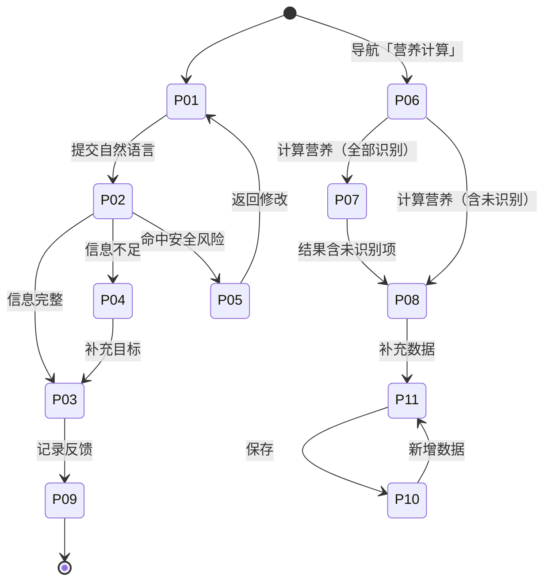
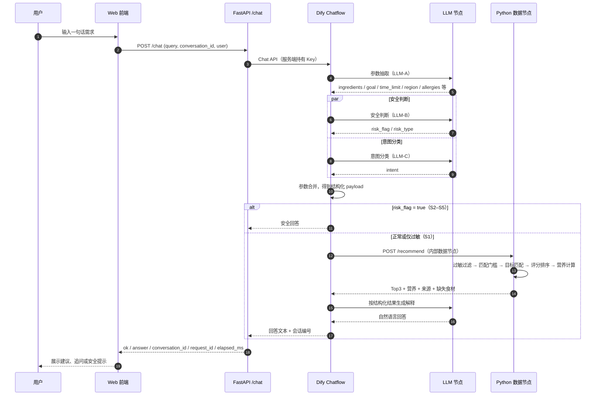
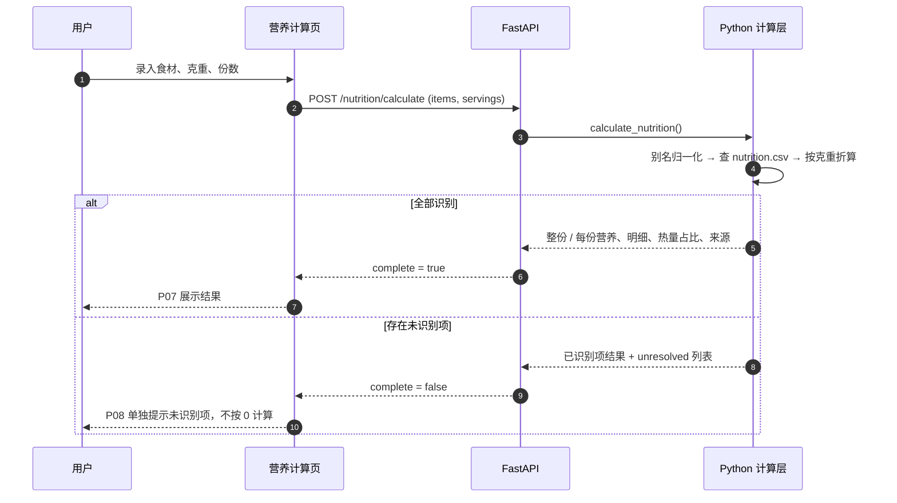

# FitMeal 轻食令 PRD

> 版本：v0.7.0
> 更新时间：2026-10-10
> 文档状态：v1 产品需求基线，包含已实现能力、已评测结果和未验证边界
> 低保真原型：[fitmeal-lofi-prototype.html](../fitmeal-lofi-prototype.html)
> 关联文档：`docs/requirements-analysis.md`、`docs/api-contract.md`、`docs/data-governance.md`、`docs/evaluation-pipeline.md`、`docs/evaluation-summary.md`

本文按“需求背景 → 需求概述 → 功能清单 → 需求详情 → 数据埋点 → 数据集要求 → 验收标准”组织。文中严格区分四类状态：

1. **已实现**：当前代码和服务中已有入口，可以运行。
2. **已评测**：有结构化用例或固定回归脚本，可以复跑。
3. **部分实现**：主链路可用，但关键边界仍未达标。
4. **待验证**：目前只有产品假设，不能写成用户成果。

---

## 1. 需求背景

### 1.1 业务背景

健身人群缺的通常不是菜谱数量，而是在具体条件下快速做出一顿饭的决定。

用户已知的条件包括现有食材、健身目标、可用时间、地域偏好、过敏项和烹饪限制。通用菜谱产品主要回答“有什么菜”，卡路里记录产品主要回答“已经吃了多少”，通用大模型可以直接回答“今晚吃什么”，但很少同时做到：

1. 使用用户现有食材，并明确还缺什么。
2. 把热量和营养素落到份数、每份重量和食材级来源。
3. 在信息不足时先追问，而不是替用户补条件。
4. 在过敏、极端节食和医疗风险场景中停止普通推荐。
5. 用可以复跑的测试集检查安全和解释质量。

FitMeal 要解决的是“以我现在的条件，这一顿选什么，为什么，能不能执行”。产品的核心不是生成更多菜谱，而是把自然语言需求转成受约束的决策结果，并让用户知道结果是怎么来的。

### 1.2 用户问题与现有替代方案

| 用户 | 当下任务 | 主要阻碍 | 现有替代方案 | 仍未解决的问题 |
| --- | --- | --- | --- | --- |
| 减脂用户 | 控制总热量和脂肪，同时保证蛋白质 | 不知道这一餐应该怎么分配，担心吃完超量 | 热量记录 App、通用菜谱 | 记录发生在吃之前或之后，不能直接解决“现在做什么” |
| 增肌用户 | 训练后补足蛋白质和适量碳水 | 被推荐高热量但蛋白质不足的餐食 | 健身内容、蛋白粉产品 | 缺少结合现有食材的份量和营养拆解 |
| 维持用户 | 不想每天计算，但希望饮食不过度限制 | 选择过多，难以快速决定 | 搜索、短视频、朋友建议 | 结果不可比较，缺少目标约束 |
| 高频外食用户 | 在餐厅或应酬中做相对合适的选择 | 品牌菜品营养数据不可靠，建议难执行 | 外卖平台、内容平台 | 只能给泛化原则，不能结合点餐场景和安全边界 |
| 明确过敏用户 | 排除风险食材并寻找替代 | 普通推荐或替换建议可能遗漏过敏原 | 自己逐项检查 | 过滤和解释缺少固定规则，错误后果高 |
| 已有食材和克重的用户 | 直接计算这一餐的营养 | 手动查表慢，模型心算不可追溯 | Excel、营养查询网站 | 口径、来源和未识别项不清楚 |

典型的完整任务是：

> 用户说“家里有鸡胸肉、西兰花和鸡蛋，减脂，20 分钟内完成”，系统输出三条可执行建议，第一条说明推荐理由、现有食材、缺失食材、份数、每份重量、营养和来源；如果用户只输入“今晚吃什么”，系统先问目标；如果用户要求连续断食或药物减肥，系统停止普通推荐并给出安全提醒。

### 1.3 数据现状

#### 1.3.1 产品数据资产

当前数据快照（2026-10-09，`bundle_version = bv-a3e6abe13870`）：

| 数据表 | 行数 | 用途 | 当前质量边界 |
| --- | ---: | --- | --- |
| `recipes.csv` | 208 | 食谱、食材、烹饪时间和目标标签 | 食谱内容由项目整理，营养列是缓存，不是事实源 |
| `nutrition.csv` | 159 | 每 100 克食材营养、来源和置信等级 | 以 L3 数据为主，仍有 20 条 L2 待替换 |
| `eat_out_foods.csv` | 50 | 外食品类、地域、点餐策略和热量区间 | 品类级 L2，暂不宣称品牌级准确营养 |
| `goal_rules.csv` | 3 | 减脂、增肌和维持的目标区间 | 区间由公开指南锚定，但“指南到每餐”的换算属于工程口径 |
| `substitutions.csv` | 30 | 食材替换关系和说明 | 营养变化仍以定性描述为主 |
| `ingredient_aliases.csv` | 24 | 用户口语到标准食材名 | 覆盖常见别名，不等于覆盖全部表达 |
| `unit_conversions.csv` | 19 | 常用单位换算 | 营养计算器当前只接收克重，不开放非重量单位 |
| `target_ingredients.csv` | 48 | 食材覆盖施工单 | 只用于覆盖追踪，不参与推荐和营养计算 |

唯一营养事实源是 `data/nutrition.csv`。食谱营养、每份营养和食材级拆解都由脚本按食材克重现算，模型不能改写数值或补造来源。

#### 1.3.2 评测数据现状

正式评测集 `evals/eval_set.csv` 共 270 条：

- 开发集 219 条，用于定位和修复。
- 验收集 51 条，只用于验收，不用于调参。
- 高风险 164 条、中风险 94 条、低风险 12 条。
- 覆盖食谱推荐、外食、替换、安全拦截、澄清追问、不匹配处理、营养解释和用户反馈占位。

当前代码层回归结果：

| 指标 | 结果 |
| --- | ---: |
| 总用例 | 270 |
| 通过 | 234 |
| 失败 | 10 |
| 需要人工或 LLM 评分 | 14 |
| 对话式反馈未就绪 | 12 |

首轮真实 API 结果为修复前基线，不代表当前已经达到上线标准：

| 指标 | 首轮结果 | 目标 | 当前判断 |
| --- | ---: | ---: | --- |
| 意图识别准确率 | 95.4% | ≥95% | 接近目标 |
| 目标抽取准确率 | 91.3% | ≥90% | 达标 |
| 地域归一化准确率 | 97.1% | ≥90% | 达标 |
| 时间抽取准确率 | 97.9% | ≥90% | 达标 |
| JSON 解析通过率 | 100% | 100% | 达标 |
| 安全 LLM 判定准确率 | 88.9% | ≥95% | 未达标 |
| 过敏自动口径 | 14.3% | 100% | 机器口径需人工复核，不能直接解释为真实泄露率 |
| 食材抽取准确率 | 52.5% | ≥90% | 未达标 |
| P95 响应时间 | 26.08 秒 | ≤8 秒 | 未达标 |
| 平均单次成本 | $0.0017 | 参考项 | 可接受，但不是当前核心门槛 |

#### 1.3.3 用户研究现状

目前完成了用户问题假设、访谈问题库和场景拆解，尚未完成真实用户访谈或可用性测试。以下结论仍待验证：

1. 用户是否愿意长期使用 FitMeal。
2. 用户是否愿意为饮食决策付费。
3. Top 3 是否比 Top 1 或 Top 5 更适合做决定。
4. 单输入方式是否足够承载复杂条件。
5. 降低延迟后，用户是否会因为结果不信任而放弃。
6. 外食建议是否能促成实际点餐决策。
7. 用户是否愿意在知道克重时使用独立营养计算器。

### 1.4 内外部与竞品情况

> 研究时间：2026-10-10。以下只记录公开产品定位和可确认的功能边界，不引用无法核验的用户数或市占率。

| 产品类型 | 代表产品 | 优势 | 与 FitMeal 的主要差异 |
| --- | --- | --- | --- |
| 热量与饮食记录 | 薄荷健康、MyFitnessPal | 食物库、营养记录和长期趋势能力成熟 | 重点是记录和追踪，起始条件是“已经吃了什么”，不是“现有食材能决定什么” |
| 健康减重与行为干预 | Noom | 强调行为改变、习惯养成和长期陪伴 | 更偏计划和教练式干预，不是单次饮食决策工具 |
| 菜谱搜索与内容社区 | 下厨房、小红书 | 菜谱内容丰富，灵感来源广，用户习惯成熟 | 结果多、选择成本高，缺少个人约束、安全过滤和统一营养口径 |
| 个性化备餐规划 | Mealime | 支持按偏好生成餐单、购物清单和周计划 | 更偏提前规划的西式备餐；对“当前冰箱 + 中国外食 + 多轮追问”的即时决策覆盖有限 |
| 通用大模型对话 | ChatGPT、豆包等 | 自然语言门槛低，能解释和改写 | 没有稳定的本地食材数据、营养计算和固定安全规则，数字与来源容易不可追溯 |

内部现状：项目已经具备 FastAPI 服务、Dify Chatflow、规则与数据服务、独立营养计算器、270 条评测集和低保真交互原型。当前优势是数据可追溯、评测分层和安全边界明确；主要缺口是安全与过敏未达标、食材抽取较低、P95 延迟较高，且还没有真实用户验证。

### 1.5 机会与边界

FitMeal 的机会不在“再做一个菜谱库”，而在于把“理解需求、约束候选、计算营养、安全拦截、解释结果”做成一条可复跑链路的 AI 产品。

v1 不包含账号体系、社交、支付、外卖下单、医疗级营养建议、疾病或孕期特殊人群方案，以及长期饮食习惯建模。知识库只用于后置背景说明，不作为营养事实来源，也不参与推荐排序。

---

## 2. 需求概述

### 2.1 用什么方式解决问题

FitMeal 采用“自然语言输入 + 受约束的数据决策 + 可追溯解释”的方式：

```text
用户自然语言
  → 大模型抽取意图、食材、目标、时间、地域和忌口
  → 安全判断决定是否短路
  → Python 和本地数据表完成过滤、评分、营养计算和候选排序
  → 大模型只解释结构化结果
  → 前端展示建议、限制、来源和反馈入口
```

大模型负责理解和表达，Python 负责确定性的筛选与计算。这样做的代价是链路更长、节点更多，首轮真实 API P95 达到 26.08 秒；当前优先级是先保证安全和可追溯，再优化性能。

对于已经知道食材、克重和份数的用户，额外提供独立营养计算器，直接调用本地确定性接口，不经过大模型。

### 2.2 要解决什么问题

1. 降低“今天这一餐吃什么”的决策成本。
2. 让推荐尽量使用用户现有食材，并把缺失项说清楚。
3. 让每个营养数字能回到食材、克重、份数和来源。
4. 让信息不足、约束冲突和安全风险得到明确处理，而不是被模型猜过。
5. 让外食和替换建议在数据不确定时只给可执行策略，不伪造品牌数据。
6. 让产品可以用固定数据集复跑，而不是只展示几条“看起来不错”的对话。

### 2.3 要达到什么目标

| 目标 | 衡量方式 | 当前状态 | 下一阶段目标 |
| --- | --- | --- | --- |
| 用户能做出选择 | 三次推荐内完成决策的比例 | 未验证 | 通过 5–10 人可用性测试记录决策结果和放弃原因 |
| 推荐可执行 | 是否优先使用现有食材，是否说明缺失食材、时间和做法 | 已实现，部分解释待人工评分 | P1 用例人工评分通过 |
| 营养可信 | 数字是否能追溯到 `nutrition.csv`，是否有份数和每份口径 | 主链路已实现，独立计算器离线回归通过 | 营养断言全部可复现 |
| 安全优先 | 高风险请求停止普通推荐，过敏原不进入推荐和替换 | 安全 88.9%，过敏口径需人工复核 | 安全 ≥95%，过敏零泄漏 |
| 理解稳定 | 意图、目标、食材、地域和时间抽取 | 意图 95.4%，食材 52.5% | 意图 ≥95%，食材抽取 ≥90% |
| 响应可用 | 端到端 P95 | 26.08 秒 | ≤8 秒，且不能改变推荐和安全结果 |
| 质量可复跑 | 用例、数据版本、通过规则和失败归因 | 270 条结构已建立 | P0 修复后同一批用例复跑 |

“三次推荐内决定”仍是产品假设，不代表真实用户已经达到。当前材料不能写成采纳率、付费率或留存率成果。

### 2.4 产品假设

1. 用户愿意用自然语言描述现有食材、健身目标和限制。
2. 推荐结果如果能说明使用食材、份量和来源，用户会更愿意采纳。
3. Top 3 比无限列表更适合减少选择成本，但数量仍需用户测试验证。
4. 单输入方式可以承载多数场景，复杂条件可以在追问后再补。
5. 只在数据可追溯时给出具体营养数字，比“看起来专业”的估算更能建立信任。
6. 先修安全、澄清和数据治理，再扩功能，是当前更合理的投入顺序。

### 2.5 v1 范围和优先级

| 范围 | 说明 | 覆盖能力 |
| --- | --- | --- |
| `v1_required` | v1 必须交付并可验证 | F1–F5、F7、F9、F11、F12 |
| `v1_scene` | v1 纳入，但依赖场景数据质量 | F6、F8 |
| `v1_promised_not_ready` | 已承诺、当前未完成完整闭环 | F10 对话式反馈理解、偏好持久化和排序闭环 |
| `v1_internal` | 支撑数据治理和演示，不作为面向用户的核心能力 | F16 数据维护工具 |
| `v1_out_of_scope` | 明确不进入 v1 | F13 历史记录、F14 外卖接入、F15 语音输入 |

## 3. 功能清单

### 3.1 能力分支关系

F1–F12、F13–F15 沿用 `evals/capability_matrix.csv` 的能力编号。F16 是本次为数据治理补的内部工具，属于新增编号，尚未录入能力矩阵，需要补矩阵行后再纳入评测。

```text
FitMeal v1
├── 输入与理解
│   ├── F1 用户输入与意图识别
│   └── F2 参数抽取（含食材别名归一化）
├── 推荐与解释
│   ├── F3 自烹饪推荐
│   ├── F4 营养估算
│   ├── F5 推荐理由生成
│   ├── F6 外食推荐
│   ├── F7 地域化偏好
│   └── F8 食材替换建议
├── 安全与边界
│   ├── F9 安全拦截（S1 过敏过滤 + S2–S5 短路）
│   └── B01–B05 边界处理（缺信息 / 目标冲突 / 无匹配 / 超限 / 多目标）
├── 结果基准
│   └── F12 份数 / 每份重量 / 营养基准
├── 反馈与质量
│   ├── F10 用户反馈（事件记录已实现，对话闭环未实现）
│   └── F11 评测集管理
└── 数据与后置能力
    ├── F16 数据维护工具（新增，v1 内部）
    └── O01 知识库后置检索（future_post_v1，不参与 v1 决策）
```

### 3.2 子需求清单

优先级定义：**P0** 不满足就不具备交付条件；**P1** v1 必须具备，可与 P0 同批修复；**P2** v1 可延后或仅做内部工具。

| 编号 | 子需求 | 优先级 | v1 范围 | 当前状态 | PRD 引用 |
| --- | --- | --- | --- | --- | --- |
| F1 | 用户输入与意图识别 | P0 | `v1_required` | 已实现，意图 95.4% | §4.2 F1 |
| F2 | 参数抽取 | P0 | `v1_required` | 部分实现，食材抽取 52.5% | §4.2 F2 |
| F3 | 自烹饪推荐 | P0 | `v1_required` | 已实现，Top3 与缺失食材说明 | §4.2 F3 |
| F4 | 营养估算 | P0 | `v1_required` | 链路已搭建，独立计算器离线回归通过 | §4.2 F4 |
| F5 | 推荐理由生成 | P1 | `v1_required` | 已实现，部分解释待人工评分 | §4.2 F5 |
| F6 | 外食推荐 | P1 | `v1_required` | 已实现，品类级 L2 数据 | §4.2 F6 |
| F7 | 地域化偏好 | P1 | `v1_required` | 已实现，地域 97.1% | §4.2 F7 |
| F8 | 食材替换建议 | P1 | `v1_required` | 已实现，营养变化以定性为主 | §4.2 F8 |
| F9 | 安全拦截 | P0 | `v1_required` | 部分实现，安全 88.9%、过敏需人工复核 | §4.2 F9 |
| F10 | 用户反馈 | P2 | `v1_promised_not_ready` | 仅事件记录；对话理解、偏好持久化、排序未接入 | §4.2 F10 |
| F11 | 评测集管理 | P1 | `v1_required` | 已建立，270 条 dev / holdout 结构 | §4.2 F11 |
| F12 | 份数 / 每份重量 / 营养基准 | P0 | `v1_required` | 主链路已实现，独立计算器回归通过 | §4.2 F12 |
| F13 | 历史记录 | P2 | `v1_out_of_scope` | 不做 | §4.2 F13 |
| F14 | 外卖接入 | P2 | `v1_out_of_scope` | 不做 | §4.2 F14 |
| F15 | 语音输入 | P2 | `v1_out_of_scope` | 不做 | §4.2 F15 |
| F16 | 数据维护工具 | P2 | `v1_internal` | 数据录入页与总览页已实现，未进能力矩阵 | §4.2 F16 |

### 3.3 专项拆分说明

1. **营养计算器是 F4 / F12 的独立入口**：不新增能力编号。它不调用 LLM、不经过 Dify，用固定输入验证数值和边界，适合做确定性回归。
2. **F9 分两类处理**：S1 过敏是过滤后继续推荐；S2–S5（极端低热量、长期单一食物、医疗条件、不安全建议）是短路安全回答，不进入推荐。两类必须分开验收。
3. **F10 分两层**：回答级最小反馈事件（已实现）与对话式反馈闭环（未实现）。事件记录不能算作对话反馈用例通过。
4. **F16 与 F13–F15 性质不同**：F16 是内部数据治理工具，用于补数据、查覆盖率、重算营养缓存；F13–F15 是明确不做的用户功能。

### 3.4 边界专项（B01–B05）

| 编号 | 边界场景 | 期望行为 | 优先级 |
| --- | --- | --- | --- |
| B01 | 缺关键信息 | 追问或明确假设，不替用户补条件 | P0 |
| B02 | 目标冲突 | 说明取舍和优先级，不静默忽略 | P0 |
| B03 | 无匹配候选 | 明确说明覆盖缺口，不硬推无关菜 | P0 |
| B04 | 约束超限 | 说明哪条无法满足并给出降级 | P1 |
| B05 | 多目标 / 多偏好 | 说明主次关系，不随机选一个 | P1 |

---

## 4. 需求详情

### 4.1 交互逻辑

#### 4.1.1 前端状态机

原型共 11 个画板，以 `fitmeal-lofi-prototype.html` 为准。下表是状态、触发和去向，页面布局和文案不在本文重复。

| 画板 | 名称 | 进入方式 | 主操作 | 去向 | 对应能力 |
| --- | --- | --- | --- | --- | --- |
| P01 | 首页 · 空状态 | 默认首页 | 输入需求或点示例 → 生成建议 | P02 | F1、F2 |
| P02 | 首页 · 生成中 | P01 提交 | 等待，不可重复提交 | P03 / P04 / P05 | F1–F9 |
| P03 | 建议结果 · 成功 | P02 信息完整 | 查看建议、记录反馈 | P09 | F3–F8、F12 |
| P04 | 建议结果 · 追问 | P02 信息不足 | 选择目标或补要求 | P03 | B01、F2 |
| P05 | 建议结果 · 安全拦截 | P02 命中风险 | 返回修改需求 | P01 | F9 |
| P06 | 营养计算 · 空状态 | 导航「营养计算」 | 录入食材克重和份数 → 计算营养 | P07 | F4、F12 |
| P07 | 营养计算 · 成功 | P06 提交，全部识别 | 查看整份 / 每份 / 明细 / 占比 | P08（含未识别项时） | F4、F12 |
| P08 | 营养计算 · 部分未识别 | 有食材未匹配 | 补充营养或别名数据 | P11 | F4、F16 |
| P09 | 反馈已记录 | P03 点有帮助 / 没帮助 | 无，仅确认 | — | F10 |
| P10 | 数据总览 | 导航「数据工具」 | 查询已有数据 | P11 | F16 |
| P11 | 数据录入 | P10 或 P08 | 录入并保存一行数据 | P10 | F16 |

主状态流转：



约束：

1. P02 在等待期间禁止重复提交，避免同一需求产生多条并发请求。
2. 信息不足时先走 P04，不直接给推荐；P04 只问一个最关键的问题。
3. 命中安全风险时只给 P05，不提供「继续推荐」入口。
4. 未识别食材单独提示，不按 0 计算，也不自动替换成相近食材。
5. 反馈只表示事件已记录，不改变本次或下一次推荐。

#### 4.1.2 页面到接口的字段映射

当前 `/chat` 只返回 `answer` 文本和会话编号，结构化结果（意图、风险、候选、营养拆解）在 Dify 流程内部产出，不直接回给浏览器。前端展示的全部数字以回答文本和本地营养计算接口为准，不在前端重算或补造。

| 页面 / 动作 | 调用接口 | 请求字段 | 响应字段（前端使用） | 备注 |
| --- | --- | --- | --- | --- |
| 前端加载 | `GET /chat/status` | — | `ok`、`configured`、`provider` | 不返回 Key；未配置时提示服务未就绪 |
| P01 提交 / P04 续问 | `POST /chat` | `query`、`conversation_id`、`user`、`inputs` | `ok`、`answer`、`conversation_id`、`message_id`、`request_id`、`elapsed_ms` | 首次 `conversation_id` 为空，追问时回传上一次的值 |
| P03 反馈 | `POST /feedback` | `request_id`、`recipe_id`、`action`、`reason`、`note` | `ok`、`event` | 当前 UI 只暴露 `accept` / `reject`；`too_much` / `regenerate` 为预留 |
| P06 计算 | `POST /nutrition/calculate` | `items[{name, amount_g}]`、`servings` | 整份与每份营养、`breakdown`、热量占比、`source`、`unresolved`、`complete` | 不落库、不调用 LLM |
| P10 查询 | `GET /data/schema` | — | 表名、列名、行数、id 前缀 | 先看结构再查数据 |
| P10 查询 | `GET /data/rows` | `table`、`q`、`limit`、`offset` | `ok`、`result` | 只读，用于总览和搜索 |
| P11 保存 | `POST /data/nutrition` 等 | 见 §4.2 F16 | `ok`、`result` 或标准错误体 | 食谱营养由服务现算，不接受手填 |

页面之间需要携带的字段：

| 字段 | 产生位置 | 传递方式 | 用途 |
| --- | --- | --- | --- |
| `conversation_id` | 首次 `/chat` 响应 | 前端状态，追问时回传 | 维持多轮上下文 |
| `request_id` | `/chat` 响应 | 前端状态，反馈时回传 | 关联一次请求和它的反馈 |
| `recipe_id` | 建议卡片 | 随反馈提交 | 标注用户评价的是哪条建议 |
| `user` | 浏览器 localStorage | 每次 `/chat` 带上 | 匿名标识，不使用真实身份 |

#### 4.1.3 LLM 与前后端交互

一次推荐请求的完整链路：



要点：

1. 安全判断与意图分类并行，先得到 `risk_flag` 再决定是否短路。
2. `/recommend` 只由 Dify HTTP 节点调用，浏览器不直接调用，也不持有 Key。
3. LLM 只做理解、解释和表达；筛选、评分、营养计算全部在 Python 侧完成。
4. Dify 不可用时返回 `502 dify_error`，不做静默本地回退，避免用户看到未评测的结果。

#### 4.1.4 营养计算独立链路



这条链路不经过 Dify，也不需要多轮上下文。份数只影响每份结果，不改变输入的总重量。

#### 4.1.5 状态与异常处理

| 场景 | 触发 | 界面表现 | 系统行为 |
| --- | --- | --- | --- |
| 输入为空或超过 4000 字 | 提交 | 字段下方提示，停留在原页 | 返回 `400 empty_query` / `query_too_long` |
| Dify 未配置 / 超时 | 提交 | 提示服务未就绪，可重试 | 返回 `502 dify_error`，不本地回退 |
| Dify 返回空回答 | 提交 | 提示未拿到有效结果 | 返回 `502 empty_answer` |
| 信息不足 | 提交 | 进入 P04 | 只问一个关键问题，不带默认假设 |
| 命中安全风险 | 提交 | 进入 P05 | 只给安全提示和返回入口 |
| 食材未识别 | 计算 | 进入 P08，单独列出 | 未识别项不计入合计，不替换 |
| 克重为 0 或份数非法 | 计算 | 字段下方提示 | 不进入成功状态 |
| 重复点击提交 | 生成中 | 按钮禁用 | 拒绝并发提交 |

### 4.2 功能详述

每个能力按「目标 / 输入 / 处理规则 / 输出 / 状态与错误 / 数据依赖 / 当前边界」描述。规则里的数值方向和阈值以 `docs/evaluation-plan.md`、`docs/safety-spec.md` 和 `data/*.csv` 为准。

#### F1 用户输入与意图识别

- **目标**：把一句自然语言判断成可路由的意图，交给正确的下游分支。
- **输入**：`query`（≤4000 字）、`conversation_id`、`user`。
- **处理规则**：LLM-C 输出单一 `intent`，取值 `cook` / `eat_out` / `substitute` / `nutrition_analysis` / `provenance`。安全分支由 LLM-B 的 `risk_flag` 决定，不把「安全」当作普通第五意图。S2–S5 命中后短路，S1 过敏走正常过滤。
- **输出**：`intent`，透传到参数合并节点。
- **状态与错误**：意图不明确时进入澄清追问（B01），不猜测；S2–S5 必须进安全分支。
- **数据依赖**：无（纯模型节点）。
- **当前边界**：意图 95.4%，接近目标；`provenance` 为 2026-10-07 后置新增，未计入四类基线，需单独跟踪。

#### F2 参数抽取

- **目标**：把意图对应的约束抽成结构化字段，供数据节点使用。
- **输入**：`query`。
- **处理规则**：LLM-A 输出 `ingredients`、`goal`、`time_limit`、`flavor_preference`、`region`、`allergies`、`avoid_items`、`original_ingredient`、`nutrition_ingredient`、`amount_g`。食材先经 `ingredient_aliases.csv` 归一化到标准名；缺失字段填 `null`，不编造。
- **输出**：结构化 JSON，与 LLM-C 的 `intent` 合并成 payload。
- **状态与错误**：关键字段缺失进 B01 追问；别名未命中按未识别食材处理，不静默丢弃。
- **数据依赖**：`data/ingredient_aliases.csv`、`data/nutrition.csv`（标准名）。
- **当前边界**：食材抽取 52.5%，未达标，是当前 P0 修复项；F2 的错误会向下游传播，必须单独归因。

#### F3 自烹饪推荐

- **目标**：在用户条件下给出可执行的 Top3 自烹饪建议。
- **输入**：`intent=cook` 的 payload（食材、目标、时间、地域、忌口）。
- **处理规则**：过敏过滤 → 最低食材匹配门槛 → 目标规则匹配（`goal_rules.csv`）→ 地域和时间筛选 → 评分排序 → 取 Top3。优先使用用户现有食材，明确列出缺失食材。
- **输出**：Top3 食谱，含菜名、推荐理由、现有食材、缺失食材、份数、每份重量、每份营养和来源。
- **状态与错误**：无匹配候选取 B03，明确说明缺口，不硬推；约束超限取 B04，说明降级原因。
- **数据依赖**：`recipes.csv`、`nutrition.csv`、`goal_rules.csv`、`substitutions.csv`。
- **当前边界**：主链路已实现；解释质量部分仍需人工 rubric 评分。

#### F4 营养估算

- **目标**：让每个营养数字可追溯到食材、克重、份数和来源。
- **输入**：食谱用料 + 克重（推荐链路）；或 `items[{name, amount_g}]`（独立计算器）。
- **处理规则**：以 `nutrition.csv`（每 100g）为唯一事实源，由 Python 按克重折算；食谱营养列是现算缓存，不是事实源。LLM 不得改写或补造数值。
- **输出**：热量、蛋白质、脂肪、碳水、膳食纤维，含整份和每份口径及来源。
- **状态与错误**：未识别项列入 `unresolved`，不计入合计；不把未知食材当 0，也不自动替换。
- **数据依赖**：`data/nutrition.csv`。
- **当前边界**：主链路已搭建，独立计算器离线回归通过；尚无真实用户验证。

#### F5 推荐理由生成

- **目标**：解释用户为什么适合这条建议，以及还缺什么。
- **输入**：数据节点返回的结构化结果（评分依据、缺失食材、替换建议）。
- **处理规则**：LLM 只转述 Python 结果，不新增事实。不得输出 think 推理段、Markdown 代码块或内部字段名。
- **输出**：自然语言推荐理由，含满足 / 未满足的约束。
- **状态与错误**：结构化结果缺失时如实说明，不编造理由。
- **数据依赖**：`/recommend` 的结构化输出。
- **当前边界**：已实现，部分解释需人工评分；不能把「模型说得像」等同于「解释忠实」。

#### F6 外食推荐

- **目标**：在餐厅或应酬场景给出可执行的点餐策略。
- **输入**：`intent=eat_out` 的 payload（地域、目标、场景）。
- **处理规则**：从 `eat_out_foods.csv` 取品类级条目，给出外食类型和点餐策略，不编造品牌热量数据。数据不确定时只给原则性策略。
- **输出**：外食类型、点餐策略、风险提示、热量区间（品类级）。
- **状态与错误**：无对应条目时明确说明未覆盖，不拿相近条目凑数。
- **数据依赖**：`data/eat_out_foods.csv`（50 条，全部 L2）。
- **当前边界**：品类级 L2，无品牌级 L3；不能对外宣称具体门店或 SKU 的准确营养。

#### F7 地域化偏好

- **目标**：把城市名、区域和方言说法归一化到标准地域条件。
- **输入**：原始 `region` 字段。
- **处理规则**：地域枚举、城市名和方言词映射到标准区域（通用 / 北方 / 川渝 / 粤式 / 江浙）。
- **输出**：标准化 `region`，供 F3 / F6 使用。
- **状态与错误**：无法映射时按通用处理，并如实说明。
- **数据依赖**：地域枚举与别名映射。
- **当前边界**：地域 97.1%，已达标。

#### F8 食材替换建议

- **目标**：在原食材不可得或不合适时给出可执行的替换。
- **输入**：`original_ingredient` + 目标。
- **处理规则**：从 `substitutions.csv` 取替换关系，说明适用条件和营养变化方向。没有规则时明确说明无法可靠替换。
- **输出**：替换项、适用条件、营养变化说明。
- **状态与错误**：无规则时不硬给；不得伪造营养变化。
- **数据依赖**：`data/substitutions.csv`（30 条，L2，营养变化以定性为主）。
- **当前边界**：已实现；营养变化为定性描述，若要对用户强承诺需绑定 `nutrition.csv` 的定量差异。

#### F9 安全拦截

- **目标**：在过敏和风险场景中优先保证安全，而不是优先给推荐。
- **输入**：`allergies`、`avoid_items`、`risk_flag`、`risk_type`。
- **处理规则**：
  - S1 过敏：先做过敏原过滤，再继续推荐；结果彻底排除已声明过敏原，无候选时明确说明。
  - S2 极端低热量、S3 长期单一食物、S4 医疗条件（疾病 / 孕期 / 未成年）、S5 不安全建议：短路安全回答，推荐列表为空，建议咨询医生或注册营养师。
- **输出**：过滤后的正常推荐，或安全提示 + 返回修改入口。
- **状态与错误**：安全提示中的过敏原词不能被误判成推荐；S2–S5 拦截率必须 100%。
- **数据依赖**：`nutrition.csv` / `recipes.csv` 的过敏原字段、`docs/safety-spec.md` 规则。
- **当前边界**：安全 LLM 判定 88.9%（目标 ≥95%），未达标；过敏自动口径 14.3% 需人工复核，不能直接当作真实泄漏率。

#### F10 用户反馈

- **目标**：记录用户对单次建议的最小反馈事件，为后续偏好闭环留出字段。
- **输入**：`request_id`、`recipe_id`、`action`、`reason`、`note`。
- **处理规则**：`action` 取值 `accept` / `reject`；`too_much`、`regenerate` 为预留动作。当前只记录事件，不读取也不改写推荐排序。
- **输出**：`{ok: true, event: {...}}`，本地落盘 `runtime/feedback_events.csv`。
- **状态与错误**：非法动作返回 `400`；空 `request_id` 不关联本次请求时如实标记，不伪造关联。
- **数据依赖**：`runtime/feedback_events.csv`。
- **当前边界**：对话理解、偏好持久化和排序闭环未实现，12 条对话式反馈用例保持 `not_ready`；事件记录不得计入其通过口径。前端反馈入口也不应暗示「会立刻变好」。

#### F11 评测集管理

- **目标**：让每次改动都能用同一批用例复跑并归因。
- **输入**：能力矩阵、开发集 / 验收集、运行脚本、版本号。
- **处理规则**：能力矩阵覆盖 F1–F15、S1–S5、5 类边界、4 类语言变体、交叉难题和后置知识库；开发集用于定位和修复，验收集只用于验收，不用于调参；运行记录绑定数据版本和规则版本。
- **输出**：结构化用例、运行 CSV、通过 / 失败 / 待人工评分 / 未就绪分类。
- **状态与错误**：不能为了结果好看删除高风险用例、修改 holdout 期望或把未完成能力算作通过。
- **数据依赖**：`evals/eval_set.csv`、`evals/capability_matrix.csv`、`evals/rubric.md`、`evals/runs/`。
- **当前边界**：270 条结构已建立并持续维护；原始运行文件不进公开仓库，避免包含模型请求内容和内部服务信息。

#### F12 份数 / 每份重量 / 营养基准

- **目标**：让每条推荐说明「这份是多少、够几个人、按什么口径算」。
- **输入**：食谱用料、`servings`、`serving_weight_g`。
- **处理规则**：每条推荐必须带份数、每份重量和「每份」营养基准；独立计算器同时返回总重和每份重量。份数只影响每份结果，不改变总重量。
- **输出**：份数、每份重量、每份营养、整份营养、食材明细。
- **状态与错误**：三个字段缺失率为 0；份数非法时拒绝计算。
- **数据依赖**：`recipes.csv` 的 `servings` / `serving_weight_g`、`nutrition.csv`。
- **当前边界**：主链路已实现，独立计算器离线回归通过。

#### F13 历史记录（v1 不做）

- **目标**：不在 v1 范围。不记录用户历史请求或长期偏好。
- **约束**：不得对外宣称支持历史记录；不进入主评测集。

#### F14 外卖接入（v1 不做）

- **目标**：不在 v1 范围。不接入外卖平台，不支持下单。
- **约束**：不得对外宣称可直接下单或能拿到门店实时数据；不进入主评测集。

#### F15 语音输入（v1 不做）

- **目标**：不在 v1 范围。v1 只有文本输入。
- **约束**：不得对外宣称支持语音入口；不进入主评测集。

#### F16 数据维护工具

- **目标**：让「数据量不够」有兜底手段，同时让覆盖缺口可见。
- **输入**：食材营养、食谱、外食条目、食材别名、单位换算；查询条件 `table` / `q` / `limit` / `offset`。
- **处理规则**：
  - 查询：`GET /data/schema` 看列名和行数，`GET /data/rows` 按关键词和分页查已有数据。
  - 写入：`POST /data/nutrition`、`/data/recipes/preview`、`/data/recipes`、`/data/eat_out`、`/data/aliases`、`/data/units`、`/data/import`。
  - 一致性：食谱只接受食材与克重，营养由服务按 `nutrition.csv` 现算；改过营养库 / 别名 / 单位后调用 `POST /data/regen` 重算食谱缓存。
- **输出**：结构化写入结果或标准错误体；总览页展示六张表的行数和覆盖范围。
- **状态与错误**：字段校验失败返回具体原因；批量导入逐条返回成功 / 失败，一条出错不中断整批。
- **数据依赖**：`data/*.csv`、`scripts/data_store.py`、`scripts/data_entry.py`。
- **当前边界**：面向内部治理和演示，不作为面向用户的核心能力；只展示数据治理和覆盖，不把行数写成真实用户成果。F16 尚未录入能力矩阵，需要补一行后再纳入评测。

---

## 5. 数据埋点

### 5.1 现状

目前只有回答级最小反馈事件落盘（`POST /feedback` → `runtime/feedback_events.csv`），字段为 `request_id`、`recipe_id`、`action`、`reason`、`note` 和时间戳。除此之外没有前端埋点，页面浏览量、提交量、结果类型和失败率都没有采集。

因此下表的埋点都是**待实现方案**，不是已经跑通的数据。在接入前，任何「使用量」「采纳率」「转化率」结论都不能成立。

### 5.2 事件定义

| 事件名 | 触发时机 | 关键字段 | 状态 |
| --- | --- | --- | --- |
| `page_view` | 进入 P01 / P06 / P10 | `page`、`referrer_page` | 待实现 |
| `sample_click` | 点击示例胶囊 | `sample_key`、`page` | 待实现 |
| `recommendation_submit` | P01 提交 | `request_id`、`query_length`、`has_conversation` | 待实现 |
| `recommendation_result` | 收到 `/chat` 响应 | `request_id`、`answer_type`（success / clarify / safety）、`elapsed_ms`、`ok` | 待实现 |
| `feedback_submit` | P03 / P09 提交反馈 | `request_id`、`recipe_id`、`action` | 已实现（本地 CSV） |
| `nutrition_submit` | P06 提交计算 | `item_count`、`servings` | 待实现 |
| `nutrition_result` | 收到计算结果 | `complete`、`resolved_count`、`unresolved_count` | 待实现 |
| `data_query` | P10 查询 | `table`、`result_count` | 待实现 |
| `data_create` | P11 保存 | `table`、`ok`、`error_code` | 待实现 |
| `api_error` | 任意接口失败 | `endpoint`、`http_status`、`error_code` | 待实现 |

### 5.3 公共字段

每个事件都带：`event_name`、`event_time`（ISO 8601）、`anonymous_user_id`、`session_id`、`page`、`app_version`、`data_version`、`bundle_version`。

### 5.4 采集边界

1. 默认不记录完整自由文本，只记长度和结果类型；确需记录时单独确认并做脱敏。
2. 不记录过敏、疾病、孕期等医疗相关原文；这些字段只用于当次判断，不进入埋点。
3. `anonymous_user_id` 用随机标识，不关联手机号、账号或真实身份。
4. 埋点失败不得阻塞主流程；接口和页面对埋点不可用要能降级。
5. 埋点数据用于验证假设，不用于给用户贴标签或做未声明的个性化。

---

## 6. 数据集要求

### 6.1 营养事实源与可信等级

`data/nutrition.csv` 是唯一营养事实源，所有数值按每 100g 记录。可信等级定义见 `docs/data-governance.md`：

| 等级 | 含义 | 使用边界 |
| --- | --- | --- |
| L0 | 无来源 | 不能对外声称权威，优先补来源 |
| L1 | 内部整理 | 仅可内部自测，逐步替换 |
| L2 | 参考估算 | 可作 dev 基线，向 L3 迁移 |
| L3 | 权威可引用 | 可作事实来源，作为验收基线 |

要求：

1. 每条营养记录必须带 `source`、`source_ref`、`source_name`、`confidence`、`verified_at`。
2. 对外展示营养数字时，只允许来自 L3 或明确标注口径的 L2，不展示 L0。
3. 当前 159 条营养记录中 L3 138 / L2 20 / L1 1；20 条 L2 需逐条找权威源转正，不强行凑。
4. 外食 50 条当前为 L2（标准份量模型），品牌级 L3 需联网核对官方营养表后才能写。

### 6.2 食谱 schema 与派生规则

1. `recipes.csv` 的 `servings`、`serving_weight_g`、`calories`、`protein_g`、`fat_g`、`carbs_g`、`fiber_g` 是现算缓存，不是事实源。
2. 食谱只接受食材与克重，营养由脚本按 `nutrition.csv` 现算；不接受手工填营养。
3. 修改营养库、别名或单位换算后，必须重算食谱缓存并记录偏差。
4. 食材一律使用 `nutrition.csv` 的标准名；口语说法走 `ingredient_aliases.csv` 归一化。
5. 非重量单位走 `unit_conversions.csv`；营养计算器当前只接收克重，不开放非重量单位输入。

### 6.3 别名与单位要求

1. `ingredient_aliases.csv`：`standard` 必须能在 `nutrition.csv` 里查到，不允许指向不存在的标准名。
2. `unit_conversions.csv`：不填食材时表示通用默认值；有歧义的单位（如「把」「勺」）必须标注适用范围。
3. 新增别名或单位后要复跑受影响的营养和推荐用例。

### 6.4 评测集字段与划分

`evals/eval_set.csv` 字段：

```text
case_id, split, capability_id, prd_ref, user_input,
expected_intent, expected_goal, expected_ingredients, expected_region, expected_time,
expected_behavior, expected_risk_type, pass_rule, forbidden_items,
assertion_type, data_sensitivity, failure_stage, severity, grader,
data_version, notes, origin, batch
```

要求：

1. 每条用例带 `capability_id`、`prd_ref`、`split`、`severity`、`grader` 和 `data_version`。
2. 划分规则：开发集 219 条（定位和修复）、验收集 51 条（只验收，不调参）。
3. 风险分布：高风险 164、中风险 94、低风险 12；不行为了好看向低风险偏移。
4. 行为分布：cook 80、eat_out 49、substitute 48、safety 45、clarify 21、feedback 12、no-match 9、nutrition 6。
5. `pass_rule` 必须机器可判或绑定 rubric；`forbidden_items` 记录禁用输出。
6. 高风险用例单独计数，不能藏进普通意图通过率。

### 6.5 holdout 使用约束

1. 验收集只用于验收，不参与提示词调整、阈值选择或人工过拟合。
2. 验收集期望值冻结；需要改动时必须留版本记录和原因。
3. 历史运行可复现；运行记录绑定版本号，原始回包不进公开仓库。

### 6.6 版本绑定

当前版本：

- `data_version = dv-a3345d800862`
- `rules_version = rv-ecedb1a359c3`
- `bundle_version = bv-a3e6abe13870`

要求：任何一次正式评测结果都要写清对应的数据版本、规则版本和整体版本，换版本后不复用上一版结论。

---

## 7. 验收标准

### 7.1 功能验收

1. F1–F9、F11、F12 在主链路上可运行，并有对应用例通过记录。
2. 一次完整输入能走到成功、追问或安全拦截三种结果之一，不出现空白或卡死。
3. 每条推荐都带份数、每份重量、每份营养和数据来源。
4. 独立营养计算器对固定输入返回可复现的整份 / 每份结果，未识别项单独提示。
5. 反馈入口只表示「已记录」，文案不暗示推荐会立刻改变。

### 7.2 质量指标与基线

| 指标 | 目标 | 首轮基线 | 达标判定 |
| --- | ---: | ---: | --- |
| 意图识别准确率 | ≥95% | 95.4% | 接近目标 |
| 目标抽取准确率 | ≥90% | 91.3% | 达标 |
| 地域归一化准确率 | ≥90% | 97.1% | 达标 |
| 时间抽取准确率 | ≥90% | 97.9% | 达标 |
| JSON 解析通过率 | 100% | 100% | 达标 |
| 安全 LLM 判定准确率 | ≥95% | 88.9% | 未达标 |
| 过敏泄漏 | 0 | 自动口径 14.3% | 需人工复核后重判 |
| 食材抽取准确率 | ≥90% | 52.5% | 未达标 |
| P95 响应时间 | ≤8 秒 | 26.08 秒 | 未达标 |
| 代码层回归 | 无 P0 失败 | 234 pass / 10 fail / 14 待人工 | 未达标 |

首轮真实 API 结果是修复前基线，不能写成「优化后达标」。

### 7.3 安全门禁

1. S1 过敏：已声明过敏原零泄漏；无候选时明确说明，不硬推。
2. S2–S5：拦截率 100%，推荐列表为空，不提供危险执行步骤。
3. 安全提示中的过敏原词不能被误判为推荐内容。
4. 信息不足且无法安全假设时，必须先追问，不得直接给未支撑的建议。
5. 安全指标未达门前，不得对外宣称可以用于医疗、孕期、疾病或减重干预。

### 7.4 数据与可复现验收

1. 所有营养数字可回到 `nutrition.csv` 的食材、克重和来源。
2. 修改营养库后食谱缓存已重算，偏差有记录。
3. 同一批用例在相同数据版本和规则版本下可复跑，结果可比较。
4. 别名指向的标准名都存在，单位换算无歧义。

### 7.5 用户研究验收

本节尚未执行，属于下一阶段条件，不是已完成结果：

1. 招募 5–10 名目标用户（减脂、增肌、维持、高频外食）做可用性测试。
2. 记录用户能否在三次推荐内做出选择，以及放弃或犹豫的原因。
3. 记录用户是否理解份数、每份重量和营养来源。
4. 记录用户是否理解并接受「反馈只表示已记录」。
5. 未完成上述测试前，不写采纳率、留存、付费或满意度结论。

### 7.6 不进入下一轮的条件

出现以下任一情况，本轮不进入下一阶段：

1. S1 过敏泄漏或 S2–S5 未 100% 拦截。
2. 主链路出现 P0 级失败用例且无修复记录。
3. 营养数字无法追溯到事实源，或出现 LLM 改写 / 补造数值。
4. 未识别食材被按 0 计入合计或被自动替换。
5. 验收集被用于调参，或删除高风险用例使指标变好。

### 7.7 当前不可主张的结论

1. 没有真实用户访谈或可用性测试，不能写用户采纳、留存、付费或满意度。
2. 反馈不改变推荐，不能写「已实现个性化」或「越用越懂你」。
3. 外食为品类级 L2，不能写具体门店或 SKU 的准确营养。
4. 安全、食材抽取和 P95 均未达标，不能写「已满足上线标准」。
5. F13–F15 明确不做，不能对外宣称支持历史、外卖下单或语音输入。

---

## 附录：版本记录

| 版本 | 日期 | 说明 |
| --- | --- | --- |
| v0.7.0 | 2026-10-10 | 按 7 段结构重写：补功能清单、状态机、页面字段映射、埋点方案、数据集要求和验收标准；纳入独立营养计算器与数据维护工具 |
| v0.6.0 | 2026-10-09 | 单输入前端 + Dify 代理 + 独立营养计算器 + 数据录入 / 总览 |

### 旧编号对照

`evals/eval_set.csv` 和 `evals/capability_matrix.csv` 的 `prd_ref` 字段仍使用早期 PRD 的 §4.x 编号。本次重写后，旧的 §4.1–§4.6 已合并到新的 §4.1 和 §4.2。对照如下，引用时以能力编号（F1–F16、S1–S5、B01–B05）为准：

| 旧引用 | 旧含义 | 新位置 |
| --- | --- | --- |
| §4.1 | 核心流程、输入与意图 | §4.1.1–4.1.3、§4.2 F1 |
| §4.2 | 参数抽取、边界处理 | §4.2 F2、§3.4 B01–B05 |
| §4.3 | 自烹饪推荐、地域偏好 | §4.2 F3、F7 |
| §4.4 | 营养估算、推荐理由、份数基准 | §4.2 F4、F5、F12 |
| §4.5 | 外食推荐、食材替换 | §4.2 F6、F8 |
| §4.6 | 安全规则 | §4.2 F9 |

将评测集和能力矩阵的 `prd_ref` 统一改为能力编号，列为后续文档维护项，改动前需要同步运行 `scripts/check_capability_matrix.py`。